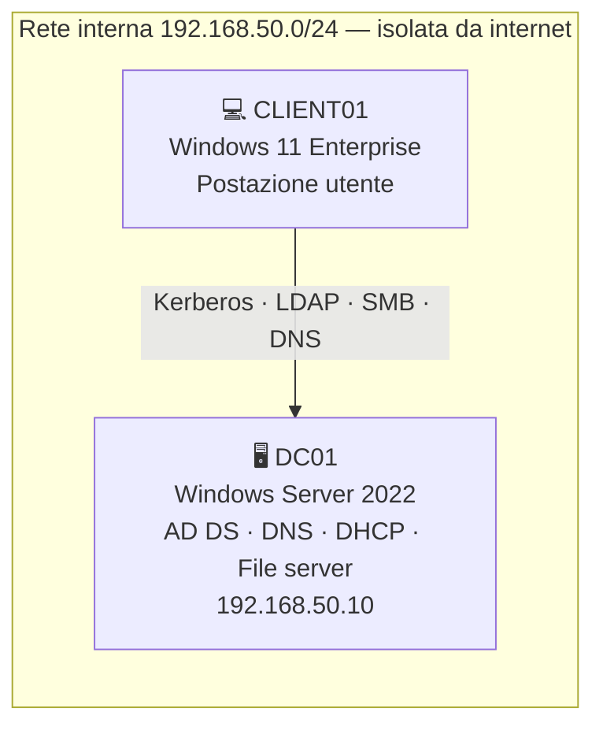

# 🏢 acme-it-lab

**Laboratorio che simula l'infrastruttura IT di una piccola azienda — ACME S.r.l., sede di Catanzaro.**

La gestisco come farebbe un tecnico di un system integrator: ogni configurazione è documentata, ogni problema è aperto come ticket con diagnosi, soluzione e verifica finale.

> Autore: **Domenico Staropoli** · CompTIA Security+ · CompTIA PenTest+ · LPIC-1 · LPIC-2

---

## 🗺️ Architettura

| Componente | Dettaglio |
|---|---|
| Dominio | `lab.internal` |
| Struttura AD | `SEDE-CATANZARO` → `utenti` · `gruppi` · `computer` · `disattivati` |
| Utenti di test | 3 utenti di reparto, gruppo `GRP-Amministrazione` |
| Hypervisor | VirtualBox su host Ryzen 5 9600X, 32 GB RAM |

---

## 🧪 Laboratori

| Lab | Argomento | Tecnologie |
|---|---|---|
| [LAB-08](labs/LAB-08-gpo-mappatura-e-restrizioni.md) | Cartella di reparto, mappatura unità e restrizioni utente | NTFS · SMB · GPO · Group Policy Preferences |

## 🎫 Ticket risolti

| Ticket | Problema | Cosa dimostra |
|---|---|---|
| [TCK-001](tickets/TCK-001-account-bloccato.md) | Account utente bloccato | Lockout policy, analisi evento 4740, sblocco AD |
| [TCK-002](tickets/TCK-002-dc01-disco-vm-perso.md) | Domain controller non si avvia | Analisi catena dischi VM, ripristino snapshot, `dcdiag` |
| [TCK-003](tickets/TCK-003-relazione-trust-client01.md) | Relazione di trust con il dominio non riuscita | Secure channel, credenziali in cache, applicazione GPO |

---

## 🛠️ Competenze dimostrate

- **Active Directory:** utenti, gruppi, OU, policy di blocco account, gestione computer del dominio
- **Group Policy:** GPO collegate per OU, Preferences con *item-level targeting*, troubleshooting con `gpresult`
- **File server:** condivisioni SMB e permessi NTFS secondo il principio del minimo privilegio
- **PowerShell:** moduli `ActiveDirectory`, `GroupPolicy`, `SmbShare`, analisi del registro eventi
- **Troubleshooting:** metodo diagnosi → causa → soluzione → verifica, documentato come ticket
- **Virtualizzazione:** snapshot, ripristino, verifica dello storage host

## 📈 Prossimi passi

- [ ] AppLocker — blocco reale dell'esecuzione di PowerShell per gli utenti standard (audit → imposizione)
- [ ] Windows LAPS per le password degli amministratori locali
- [ ] Backup dello stato del sistema del DC con Windows Server Backup
- [ ] Secondo domain controller e ruoli FSMO
- [ ] Monitoraggio con Wazuh (SIEM) e firewall OPNsense

---

⚠️ Ambiente di laboratorio: aziende, utenti, indirizzi e dati sono fittizi. Nessuna password o informazione reale è pubblicata in questo repository.
